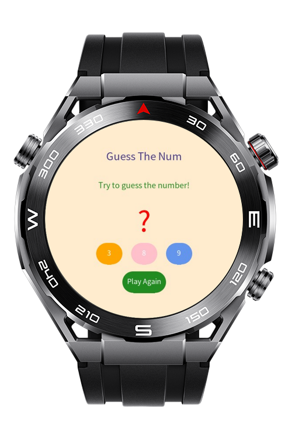

> **Note:** To access all shared projects, get information about environment setup, and view other guides, please visit [Explore-In-HMOS-Wearable Index](https://github.com/Explore-In-HMOS-Wearable/hmos-index).

# Guess The Num

HarmonyOS Lite Wearable application that allows users to play a simple number guessing game. Users are presented with
three randomly generated numbers and must select the correct one to win. The game provides immediate feedback and
prevents starting a new round until the user makes a guess.

# Preview

<div>
  
</div>

# Use Cases

- Randomly generate 3 numbers for the player to guess
- Reveal the secret number after a guess is made
- Immediate feedback for correct or wrong guesses
- Prevent starting a new game until the current guess is made
- Simple and intuitive interface optimized for wearable devices

# Tech Stack

- **Languages**: JavaScript
- **Frameworks**: HarmonyOS SDK 4.0.0(10)
- **Tools**: DevEco Studio Vers 5.1.0.842

# Directory Structure

```
entry/src/main/js/MainAbility
│    pages/
│     └── index.css
│     └── index.hml
│     └── index.js
└──  i18n
├── en-US.json
└── zh-CN.json
└──  app.js
```

# Constraints and Restrictions

## Supported Devices

- Huawei Lite Wearable
- HarmonyOS-compatible devices supporting JS UI pages

# License

Guess The Num is distributed under the terms of the **MIT License**.  
See the [LICENSE](/LICENSE) file for more information.